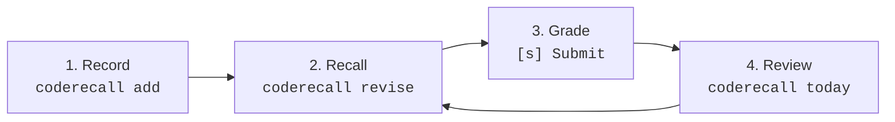

# CodeRecaller

**Local-first coding practice memory with active recall and spaced repetition.**

[](https://github.com/aaryx/CodeRecaller/actions/workflows/ci.yml)

[](LICENSE)

---

## The Problem

Software engineers frequently solve complex algorithmic problems during interview preparation or daily engineering work, but forget core implementation patterns weeks later. 

Traditional flashcards (like Anki) test passive visual recognition or abstract trivia rather than writing actual code from memory. Static markdown notes and spreadsheets require high manual overhead to maintain and cannot mathematically optimize review intervals.

**CodeRecaller** provides a local-first, terminal-native practice workflow that enforces active recall: it hides your past solutions, provides a blank workspace for deliberate re-implementation from memory, and schedules future reviews using the modern Free Spaced Repetition Scheduler (FSRS v4).

---

## Core Workflow: Record &rarr; Recall &rarr; Grade &rarr; Review



1. **Record**: Capture a working code solution into your catalog with metadata, topics, and complexity notes (`coderecall add`).
2. **Recall**: When a review is due, CodeRecaller conceals your original code and generates a clean, blank workspace for you to re-implement the pattern from memory (`coderecall revise`).
3. **Grade**: Submit an honest self-assessment rating (`Again`, `Hard`, `Good`, `Easy`) reflecting your recall ease.
4. **Review**: The FSRS scheduler calculates the next optimal review interval based on your memory stability, automatically surfacing due problems in `coderecall today`.

---

## Implemented Features

- **FSRS v4 Spaced Repetition**: Modern Free Spaced Repetition Scheduler alongside classic interval scheduling, targeting customizable retention rates (default 90%).
- **Active Recall Blank Workspaces**: Conceals past solutions during practice; requires saving non-empty code attempts before accepting passing reviews.
- **Selective Git Staging**: Automatically commits **only** problem-owned solution files and documentation; unrelated working tree changes are never touched.
- **Commit-Time Secret Scanner**: Automatically scans outgoing commits for inadvertent cloud access keys, API tokens, and private RSA/SSH keys before Git staging.
- **Durable Local Storage**: Single atomic snapshot store (`state.json`), two-phase transaction write-ahead journaling (`transaction.json`), and OS advisory locking (`msvcrt` on Windows / `fcntl` on POSIX).
- **Multi-Format Export**: Generates self-contained interactive HTML analytics reports, full-fidelity JSON archives, CSV metrics, and Markdown summaries.
- **Comprehensive Diagnostic Engine (`doctor`)**: Inspects 15 local environment and storage integrity checks offline without network calls.
- **Console Encoding Resilience**: Automatically detects terminal capabilities and provides clean 7-bit ASCII fallbacks on legacy Windows consoles (`CP437` / `CP1252`).

---

## Prerequisites & Installation

### Prerequisites
- **Python**: `3.11`, `3.12`, or `3.13`
- **Git**: Installed and available on `PATH`
- **Docker**: *(Optional)* Only needed if using the optional container sandbox runner (`coderecall run`)

### Network Scope
Network access is required **only** during initial package installation or git cloning. Once installed, all core practice workflows, active recall sessions, diagnostics, search, and export operations execute **100% offline with zero outbound network calls**.

### Installation Methods

#### Option A: Global CLI Installation via `pipx` (Recommended)
```bash
pipx install git+https://github.com/aaryx/CodeRecaller.git
```

To evaluate the exact verified release candidate SHA:
```bash
pipx install "git+https://github.com/aaryx/CodeRecaller.git@133d3937a03efb085621ca9b3b2e0550293f4396"
```

#### Option B: From Source in a Virtual Environment
```bash
git clone https://github.com/aaryx/CodeRecaller.git
cd CodeRecaller
python -m venv .venv

# On Linux/macOS:
source .venv/bin/activate

# On Windows PowerShell:
.\.venv\Scripts\Activate.ps1

pip install .
```

Confirm installation:
```bash
coderecall --version
```
Expected output:
```
0.3.0
```

---

## Executable Quick Start

Get up and running in a clean, disposable practice directory in under two minutes:

### 1. Initialize a Practice Directory
```bash
# On Linux / macOS:
mkdir ~/my-practice && cd ~/my-practice

# On Windows PowerShell:
New-Item -ItemType Directory -Path "$HOME\my-practice" -Force; Set-Location "$HOME\my-practice"

# Initialize CodeRecaller (creates private .coderecall store)
coderecall init
```

### 2. Create a Sample Solution
```bash
# On Linux / macOS:
cat << 'EOF' > palindrome.py
def is_palindrome(s: str) -> bool:
    clean = "".join(c.lower() for c in s if c.isalnum())
    return clean == clean[::-1]
EOF

# On Windows PowerShell:
Set-Content palindrome.py @"
def is_palindrome(s: str) -> bool:
    clean = "".join(c.lower() for c in s if c.isalnum())
    return clean == clean[::-1]
"@
```

### 3. Record the Solution
```bash
coderecall add --file palindrome.py --title "Valid Palindrome" --topics string,two-pointers
```
The CLI will assign an internal ID and display:
```
problem_id: <ID>
created: True
solutions: ['palindrome.py']
```
*(You can view all stored problems anytime by running `coderecall problems`).*

### 4. Practice Active Recall
Start a practice attempt using your problem ID:
```bash
coderecall revise <problem_id>
```
1. Press `[e]` to open the blank workspace in your editor (or edit `.coderecall/workspaces/<recall_id>/solution.py` directly).
2. Write the implementation from memory and save the file.
3. Return to the terminal, press `[s]`, and enter your self-assessed result and confidence rating.

### 5. Check Next Review Information
```bash
# Inspect problem schedule and FSRS stability
coderecall problem <problem_id>

# Check daily review queue
coderecall today

# View practice analytics
coderecall stats
```

---

## Verified CLI Commands Reference

CodeRecaller subcommands support standard global flags (`--json`, `--quiet`, `--verbose`, `--non-interactive`, `--no-color`, `--dry-run`).

| Category | Command | Description |
| :--- | :--- | :--- |
| **Catalog** | `coderecall add` | Capture an existing solution into the catalog with metadata and schedule. |
| | `coderecall problems` | List and filter problems by topic, difficulty, or recall status. |
| | `coderecall problem <id>` | Inspect problem metadata, review history, and private notes. |
| | `coderecall search <query>` | Full-text search across titles, topics, external IDs, hints, and notes. |
| | `coderecall import <path>` | Batch import existing solutions (`--dry-run` and `--yes` supported). |
| | `coderecall random` | Select a practice problem; `--seed` ensures deterministic selection. |
| **Active Recall** | `coderecall revise [id]` | Begin active recall. Hides original code and prepares blank workspace. |
| | `coderecall recall submit <id>` | Submit self-assessment (`--result pass/fail`, `--confidence 1-4`, `--seconds`). |
| | `coderecall recall compare <id>` | Diff attempt workspace against original stored solution (available post-submit). |
| | `coderecall recall capture <id>` | Promote submitted attempt code into the canonical solution archive. |
| **Analytics** | `coderecall dashboard` | Terminal overview with streak, due count, and retention rate. |
| | `coderecall today` | Show reviews due today with deterministic priority ranking. |
| | `coderecall stats` | Output measured local practice metrics (solve times, pass rates). |
| | `coderecall streak` | Display continuous activity streaks calculated in UTC. |
| | `coderecall topics` | View recall rates per topic without arbitrary scoring heuristics. |
| | `coderecall weak` | Detect weak topic areas and recurring mistake categories. |
| | `coderecall export` | Export learning history to HTML, JSON, CSV, or Markdown. |
| **Maintenance** | `coderecall init` | Initialize local practice store and update `.gitignore`. |
| | `coderecall backup` | Create an idempotent, timestamped ZIP backup of learning state. |
| | `coderecall restore <file>` | Validate and safely restore learning state from backup. |
| | `coderecall git commit` | Execute owned-files-only commit with secret scanning. |
| | `coderecall sync` | Plan and execute non-destructive fast-forward or push with upstream Git. |
| | `coderecall doctor` | Verify store integrity, check schema migrations, and validate setup. |

---

## Data Storage, Privacy & Restoration

### Data Location & Architecture
CodeRecaller stores all private learning state inside a local `.coderecall/` directory in your practice folder:

| Component | Path | Versioned in Git? | Purpose |
| :--- | :--- | :--- | :--- |
| **State Snapshot** | `.coderecall/state.json` | **No** (Ignored) | Schema-versioned snapshot of problems, schedules, and reviews. |
| **Project Config** | `.coderecall/config.toml` | **No** (Ignored) | Local settings (scheduler type, retention target, streak modes). |
| **Attempt Workspaces** | `.coderecall/workspaces/` | **No** (Ignored) | Isolated blank workspaces used during active recall attempts. |
| **Write Journal** | `.coderecall/transaction.json` | **No** (Ignored) | Write-ahead journal ensuring two-phase crash recovery. |
| **Backups** | `.coderecall/backups/` | **No** (Ignored) | Bounded ZIP archives created during backup operations. |

### Git Independence
CodeRecaller does **not** mandate Git for core practice; it operates standalone from `.coderecall/state.json`. When running inside an existing Git repository, `coderecall init` automatically appends `.coderecall/` to `.gitignore`. Git features (`coderecall git commit` and `coderecall sync`) selectively commit public solution files while preserving private learning history offline.

### Backup and Restore
Create an atomic ZIP archive of your private learning data:
```bash
coderecall backup
```

To verify an archive without modifying current state:
```bash
coderecall restore <backup_path>.zip --check-only
```

To restore from a backup:
```bash
coderecall restore <backup_path>.zip --yes
```
*(CodeRecaller validates problem solution paths before restoring and creates a safety copy of current state before applying updates).*

---

## Optional Docker Execution & Limitations

To execute and verify solution scripts in an isolated container:
```bash
coderecall run <solution_file.py>
```

- **Strictly Optional**: Core problem tracking, FSRS active recall, analytics, and Git versioning do **not** require Docker.
- **Container Controls**: Runs ephemeral containers (`python:3.12-alpine`) with dropped Linux capabilities (`--cap-drop ALL`), read-only root mount, non-root execution (`--user 65534:65534`), process limits (`32`), 128 MiB RAM limit, and network isolation (`--network none`).
- **Limitations**:
  - Python scripts only (bounded to 64 KiB).
  - Requires Docker daemon running on the host machine.
  - Intended for individual developer practice safety; **not** a multi-tenant untrusted execution platform (see [Docker Threat Model](docs/docker-execution-threat-model.md)).

---

## Supported Platforms & Tested Python Versions

| Operating System | Architectures | Tested Python Versions | CI Status |
| :--- | :--- | :--- | :--- |
| **Linux (Ubuntu)** | x86_64, aarch64 | `3.11`, `3.12`, `3.13` | Verified in CI matrix |
| **macOS** | Apple Silicon, Intel | `3.11`, `3.12`, `3.13` | Verified in CI matrix |
| **Windows** | x86_64 (PowerShell / CMD) | `3.11`, `3.12`, `3.13` | Verified in CI matrix |

---

## Development Setup & Verification

To contribute or run quality checks locally:

```bash
# 1. Clone repository
git clone https://github.com/aaryx/CodeRecaller.git
cd CodeRecaller

# 2. Create virtual environment
python -m venv .venv
source .venv/bin/activate  # On Windows: .\.venv\Scripts\Activate.ps1

# 3. Install in editable mode with development dependencies
pip install --upgrade pip
pip install -e ".[dev]"

# 4. Run quality checks
ruff check .
ruff format --check .
mypy src
pytest
pip-audit --skip-editable

# 5. Run the unified automated release gate
python scripts/release_gate.py --allow-dirty
```

---

## Documentation Links

- **[Documentation Index](docs/README.md)**: Sitemap of all technical specifications and user guides.
- **[Architecture Specification](architecture.md)**: Deep dive on storage invariants, atomic replacement, and transaction journals.
- **[CLI Command Reference](docs/cli.md)**: Detailed flags and argument specifications for all CLI commands.
- **[Strategic Product Roadmap](docs/product/roadmap.md)**: Prioritized feature tiers (P0–P3) and decision principles.
- **[Developer Beta Trial Guide](docs/product/developer-trial-guide.md)**: 10–15 minute evaluation protocol for beta testers.
- **[Beta Feedback Template](docs/product/trial-feedback-template.md)**: Reusable feedback questionnaire for beta participants.
- **[Contributing Guidelines](CONTRIBUTING.md)**: Code style, commit conventions, and pull request procedures.
- **[Security Policy](SECURITY.md)**: Responsible disclosure guidelines and private vulnerability reporting route.

---

## Project Status & License

- **Status**: Version `0.3.0` is currently in active development / pre-release candidate status. (No packages are published on PyPI).
- **License**: CodeRecaller is open-source software licensed under the [MIT License](LICENSE).
- **Maintainer**: Maintained by [Aaryan Singh](https://github.com/aaryx) and CodeRecall contributors.
- **Issues & Discussions**: For bug reports and feature ideas, open an issue on the [CodeRecaller GitHub Issue Tracker](https://github.com/aaryx/CodeRecaller/issues).
