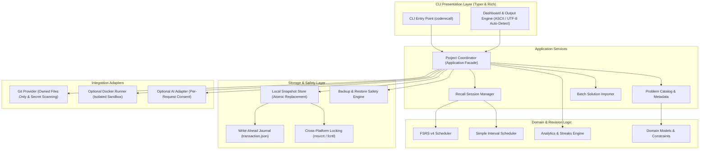
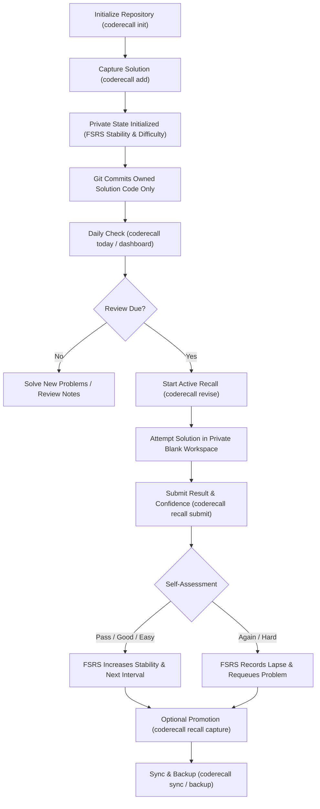

# CodeRecaller

**Practice smarter. Recall faster. Master coding.**

CodeRecaller is a local-first Python CLI for coding practice, active recall, spaced repetition, and Git-based solution tracking. It helps developers organize their practice, revisit previously solved problems, and build a more consistent learning workflow.

Unlike cloud-dependent platforms, CodeRecaller is entirely local-first and privacy-preserving: your code solutions live in your Git repository, while your revision schedules, private mistakes, hint levels, and attempt history are safely retained in a private, ignored local store. No background daemon, web server, database, or mandatory third-party account is required.

---

## Architecture Overview

CodeRecaller is structured as a clean layered architecture designed for local performance, transaction safety, and strict separation between public Git artifacts and private learning data:



---

## Core Active-Recall Workflow



---

## Key Features

- **Spaced Repetition Scheduling**: Built-in implementation of the modern **Free Spaced Repetition Scheduler (FSRS v4)** alongside a classic simple interval scheduler. Retrievability curves calculate optimal intervals based on retention targets.
- **Active Recall Workspaces**: Practice without looking at past code. `revise` generates a private, blank workspace while keeping previous solutions concealed.
- **Git-Native Solution Versioning**: Automatic, selective Git commits that stage **only** problem-owned solution files. Unrelated user edits are never staged or committed.
- **Commit-Time Secret Scanning**: Integrated regex scanning checks outgoing commits for inadvertent tokens, private keys, or API credentials before Git staging occurs.
- **Terminal Encoding Resilience**: Auto-detecting output engine supports modern UTF-8 terminals with Rich panels and emojis, while falling back gracefully to clean ASCII borders (`+---+`) and progress bars on legacy Windows terminals (`CP1252`).
- **Transaction Safety & Crash Recovery**: State updates use write-ahead transaction logging (`transaction.json`), atomic file replacement (`atomic_write`), and cross-platform file locking (`msvcrt` on Windows / `fcntl` on POSIX) to prevent corruption during unexpected shutdowns.
- **Local Analytics & Reports**: Track UTC streaks, forgetting curves, topic recall rates, and solve velocity. Export reports to JSON, Markdown, CSV, or standalone self-contained HTML.
- **Optional Sandboxed Execution**: Run Python solutions inside ephemeral, isolated Docker containers configured with dropped Linux capabilities, read-only root mounts, memory caps, and zero network access.

---

## Why CodeRecaller Exists & Intended Users

Software engineers often solve hundreds of algorithmic coding problems on platforms like LeetCode, HackerRank, or Codeforces, only to forget key patterns weeks later. Traditional flashcards test abstract trivia, not working code syntax and algorithmic intuition.

CodeRecaller is designed for:
1. **Interview Candidates**: Maintain active mastery over your practice problem catalog without cramming.
2. **Competitive Programmers**: Systematically track solution templates, time complexities, and recurring mistake categories.
3. **Lifelong Learners**: Build a private, self-owned archive of programming solutions backed by Git.

---

## Technology Stack

- **Language**: Python 3.11+
- **CLI Framework**: [Typer](https://typer.tiangolo.com/) & [Click](https://click.palletsprojects.com/)
- **Terminal UI**: [Rich](https://rich.readthedocs.io/)
- **Concurrency & Locking**: Built-in OS advisory locking (`msvcrt` on Windows, `fcntl` on POSIX)
- **Build Backend**: [Hatchling](https://hatch.pypa.io/)
- **Testing & Quality**: [Pytest](https://docs.pytest.org/), [Ruff](https://astral.sh/ruff), [Mypy](https://mypy.readthedocs.io/) (strict mode)

---

## Prerequisites & Installation

### Prerequisites
- Python 3.11, 3.12, 3.13, or 3.14
- Git (recommended for solution versioning and sync)
- Docker (optional, only required if container-isolated execution is used)

### Installation

Install CodeRecaller using [pipx](https://github.com/pypa/pipx) for an isolated global CLI installation:

```console
pipx install coderecall
```

Or install directly from the repository checkout:

```console
git clone https://github.com/aaryx/CodeRecaller.git
cd CodeRecaller
python -m pip install .
```

For local development:

```console
python -m pip install -e ".[dev]"
```

Verify the installation:

```console
coderecall --version
```

---

## Quick-Start Guide

Get up and running in under two minutes:

```console
# 1. Create and enter your solutions repository
mkdir my-practice
cd my-practice
git init

# 2. Initialize CodeRecaller (creates private .coderecall store)
coderecall init

# 3. Add your first solution
cat << 'EOF' > two_sum.py
def twoSum(nums, target):
    seen = {}
    for i, num in enumerate(nums):
        complement = target - num
        if complement in seen:
            return [seen[complement], i]
        seen[num] = i
    return []
EOF

coderecall add --file two_sum.py --title "Two Sum" --external-id 1 --platform leetcode --topics array,hash-table

# 4. Check status and daily reviews
coderecall status
coderecall dashboard

# 5. Practice via active recall
coderecall revise 1
```

---

## Verified CLI Commands Reference

CodeRecaller provides a comprehensive set of subcommands. Global flags (`--json`, `--quiet`, `--verbose`, `--non-interactive`, `--no-color`, `--dry-run`) precede the command.

| Category | Command | Description |
| :--- | :--- | :--- |
| **Catalog** | `coderecall add` | Capture an existing solution into the catalog with metadata and schedule. |
| | `coderecall problems` | List and filter problems by topic, difficulty, or recall status. |
| | `coderecall problem <id>` | Inspect problem metadata, review history, and private notes. |
| | `coderecall search <query>` | Full-text search across titles, topics, external IDs, and tags. |
| | `coderecall import <path>` | Batch import existing solutions (`--dry-run` and `--yes` supported). |
| | `coderecall random` | Select a practice problem; `--seed` ensures deterministic selection. |
| **Active Recall** | `coderecall revise [id]` | Begin active recall. Hides original code and prepares blank workspace. |
| | `coderecall recall submit <id>` | Submit self-assessment (`--result pass/fail`, `--confidence 1-4`, `--seconds`). |
| | `coderecall recall compare <id>` | Diff attempt workspace against original stored solution. |
| | `coderecall recall capture <id>` | Promote submitted attempt code into the canonical solution archive. |
| **Analytics** | `coderecall dashboard` | Terminal interactive overview with streak, due count, and retention. |
| | `coderecall today` | Show reviews due today with deterministic priority ranking. |
| | `coderecall stats` | Output measured local practice metrics (solve times, pass rates). |
| | `coderecall streak` | Display continuous activity streaks calculated in UTC. |
| | `coderecall topics` | View recall rates per topic without arbitrary scoring heuristics. |
| | `coderecall weak` | Detect weak topic areas and recurring mistake categories. |
| | `coderecall export` | Export learning history to JSON, HTML, CSV, or Markdown. |
| **Maintenance** | `coderecall init` | Initialize local repository store and update `.gitignore`. |
| | `coderecall backup` | Create an idempotent, timestamped ZIP backup of learning state. |
| | `coderecall restore <file>` | Validate and safely restore learning state from backup. |
| | `coderecall git commit` | Execute owned-files-only commit with secret scanning. |
| | `coderecall sync` | Plan and execute non-destructive fast-forward or push with upstream Git. |
| | `coderecall doctor` | Verify store integrity, check schema migrations, and validate setup. |

---

## Spaced Repetition & Revision Mechanics

CodeRecaller implements **FSRS v4 (Free Spaced Repetition Scheduler)**:

1. **Initial Review**: When a problem is captured with `coderecall add`, initial stability ($S$) and difficulty ($D$) are assigned based on initial confidence.
2. **Recall Probability ($R$)**: Over time, retrievability decays exponentially:
   $$R(t) = \left(1 + \text{FACTOR} \cdot \frac{t}{S}\right)^{\text{DECAY}}$$
3. **Review Rating**: When submitting via `coderecall recall submit`, self-assess with standard ratings:
   - `1` (**Again / Forgot**): Significant memory lapse. Stability resets and problem is requeued.
   - `2` (**Hard**): Solved with difficulty or significant hints.
   - `3` (**Good**): Solved with normal recall effort.
   - `4` (**Easy**): Effortless recall; stability receives an ease bonus.
4. **Interval Calculation**: Intervals are calculated to target the configured retention rate (default: `90%`).

Switch between schedulers anytime in configuration:

```console
coderecall config set revision.scheduler fsrs
coderecall config set revision.scheduler simple
```

---

## Git Integration & Safe Staging Model

CodeRecaller treats Git as the single source of truth for your code, but protects you from accidental leaks:

- **Owned Files Only**: `coderecall git commit` inspects the working tree and stages *only* the solution file, metadata JSON, and markdown notes belonging to the captured problem. Staged user files outside CodeRecaller's domain are never committed.
- **Secret Scanning**: Prior to committing, source diffs are checked against signatures for AWS access keys, GitHub tokens, OpenAI keys, private RSA/EC keys, and bearer tokens. Commits containing detected secrets are rejected immediately.
- **Clean Sync Protocol**: `coderecall sync` calculates a safe two-way plan (`CLEAN`, `LOCAL_AHEAD`, `REMOTE_AHEAD`, or `DIVERGED`). CodeRecaller never force-pushes, never stashes, and never rewrites Git history.

---

## Data Storage, Backups & Export

### Where Data Lives

| Data Class | Storage Location | Tracked in Git? |
| :--- | :--- | :--- |
| **Solution Source Code** | `python/0001-two-sum/solution.py` | **Yes** (Public/Committed) |
| **Problem Metadata** | `python/0001-two-sum/metadata.json` | **Yes** (Public/Committed) |
| **Review Schedules & Stability** | `.coderecall/state.json` | **No** (Strictly Ignored) |
| **Private Attempt Workspaces** | `.coderecall/workspaces/` | **No** (Strictly Ignored) |
| **Private Mistake Notes** | `.coderecall/state.json` | **No** (Strictly Ignored) |
| **Transaction Journal** | `.coderecall/transaction.json` | **No** (Strictly Ignored) |

### Backup and Restore

Create a compressed local backup of your private learning data:

```console
coderecall backup
```

Backups contain **learning state, not source code**. (Source code is already versioned by Git). To restore:

```console
coderecall restore backups/coderecall-backup-2026-10-24.zip --yes
```

### Export Formats

```console
# Standalone, interactive HTML analytics dashboard
coderecall export --format html --output report.html

# Full-fidelity JSON archive
coderecall export --format json --output learning-archive.json

# Markdown and CSV summaries
coderecall export --format markdown --output summary.md
coderecall export --format csv --output reviews.csv
```

---

## Configuration & Optional Integrations

Configuration is stored in `.coderecall/config.toml`:

```toml
[revision]
scheduler = "fsrs"
desired_retention = 0.9

[streak]
activities = "solution,review,study"

[analytics]
achievements_enabled = true
```

### Optional Docker Runner
To execute and verify code in an isolated environment without host permissions:
- Requires Docker installed locally.
- Mounts code with `--read-only`, drops Linux capabilities (`--cap-drop ALL`), drops privileges (`--security-opt no-new-privileges`), and isolates network (`--network none`).

### Optional AI Provider
- By default, zero AI calls or network requests are made.
- If enabled in `config.toml`, every invocation requires explicit user confirmation (`--consent`) before transmitting any prompt or code snippet.

---

## Privacy & Security Architecture

1. **Zero External Telemetry**: CodeRecaller makes zero outbound network requests during normal operation.
2. **Path Traversal Protection**: All file lookups and archive imports enforce strict `is_relative_to` containment checks against the project root.
3. **Advisory Locking**: High-concurrency operations acquire OS file locks (`msvcrt` on Windows / `fcntl` on POSIX) on `.coderecall/state.lock`.
4. **Crash Recovery**: Write operations maintain a write-ahead journal (`transaction.json`). Unfinished operations recover cleanly on subsequent startup.

---

## Project Structure

```
CodeRecaller/
├── .github/
│   ├── workflows/ci.yml         # Multi-platform CI pipeline
│   └── ISSUE_TEMPLATE/          # Bug and feature request templates
├── docs/                        # Deep-dive documentation
│   ├── cli.md                   # Full CLI command syntax
│   ├── configuration.md         # Configuration schema and options
│   ├── git.md                   # Git synchronization semantics
│   ├── optional.md              # Docker runner & AI adapter guides
│   ├── revision.md              # FSRS mathematical specifications
│   └── validation.md            # Benchmark and transaction measurements
├── scripts/
│   ├── benchmark_state.py       # Performance and scale benchmarking
│   └── validate_install.py      # Fresh-environment packaging test
├── src/
│   └── coderecall/
│       ├── application/         # Orchestration & catalog services
│       ├── cli/                 # Typer commands & Rich rendering
│       ├── domain/              # Models, clock, errors & analytics
│       ├── execution/           # Docker and local runners
│       ├── integrations/        # Git, GitHub, OpenAI adapters
│       ├── revision/            # FSRS v4 & simple schedulers
│       └── storage/             # Atomic store, journal & codecs
├── tests/                       # Complete regression test suite
├── pyproject.toml               # Project metadata & dependency declarations
├── LICENSE                      # MIT License
└── README.md                    # Project documentation
```

---

## Development & Testing

Run tests and linters in your local virtual environment:

```console
# Run Ruff linting
ruff check src/ tests/

# Run Ruff format check
ruff format --check src/ tests/

# Run strict type checking
mypy src

# Run test suite
pytest

# Build wheel package
python -m build --wheel --no-isolation

# Validate clean-environment installation
python scripts/validate_install.py
```

---

## Troubleshooting

- **Terminal output displays question marks or broken boxes on Windows**:
  CodeRecaller automatically falls back to ASCII borders on `CP1252` consoles. To enable full UTF-8 graphics on Windows, set `chcp 65001` or set the environment variable `PYTHONIOENCODING=utf-8`.
- **Git push fails inside restricted container/sandbox**:
  Git on Windows requires MSYS2 named kernel objects for local directory transport. Run Git push operations in a standard Windows terminal session rather than an isolated container sandbox.
- **Symlink tests skipped**:
  Windows accounts without Developer Mode enabled restrict symlink creation. CodeRecaller gracefully skips symlink tests on restricted Windows accounts without affecting functionality.

---

## Planned Roadmap

- [ ] Multi-language test runner support (C++, Java, Rust native Docker images).
- [ ] Export calendar schedules to `.ics` format for Google Calendar / Apple Calendar integration.
- [ ] Custom FSRS parameter optimization trained on individual user review history.
- [ ] Interactive terminal practice dashboard using Textual.

---

## Contributing

Contributions are welcome. Please read [CONTRIBUTING.md](CONTRIBUTING.md) and [CODE_OF_CONDUCT.md](CODE_OF_CONDUCT.md) before submitting a pull request. All changes must pass strict Mypy checks, Ruff linting, and the Pytest regression suite.

---

## License

CodeRecaller is open-source software licensed under the [MIT License](LICENSE).

---

## Maintainer & Issue Reporting

Maintained by **[Aaryan Singh](https://github.com/aaryx)**.
For bug reports and feature proposals, please submit an issue on the [CodeRecaller GitHub Issue Tracker](https://github.com/aaryx/CodeRecaller/issues).
